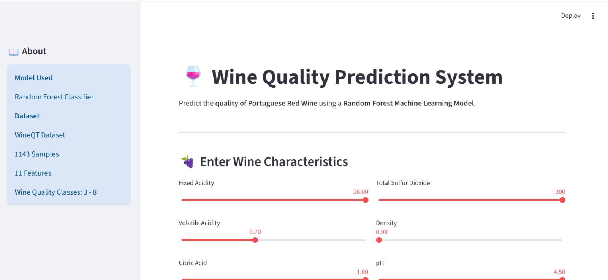
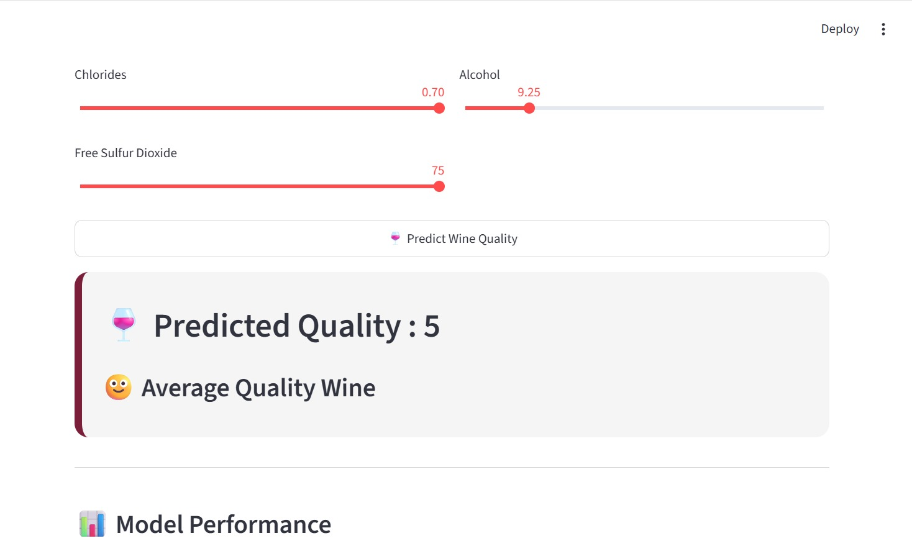
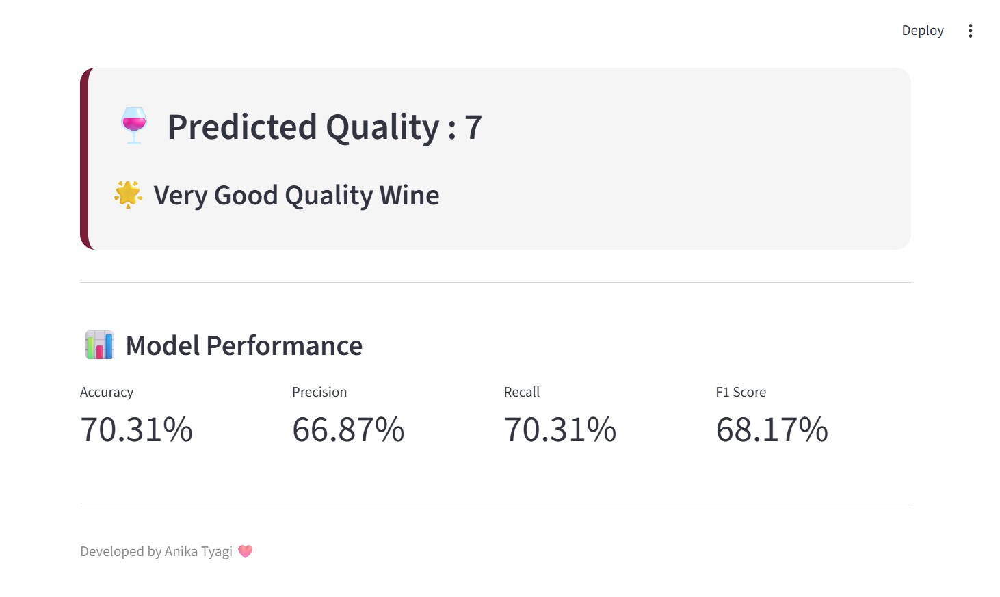

# Wine Quality Prediction using Machine Learning

## Overview

This project predicts the quality of Portuguese red wine based on its physicochemical properties using machine learning. Multiple classification algorithms were trained and evaluated, and the best-performing model was deployed through an interactive Streamlit web application.

The application allows users to enter the characteristics of a wine sample and instantly receive a predicted quality score.

---

## Problem Statement

Wine quality assessment is traditionally performed by expert tasters, making the process subjective and time-consuming. The objective of this project is to build a machine learning model capable of predicting wine quality using measurable chemical properties.

---

## Dataset

The project uses the **WineQT** dataset, which contains physicochemical measurements of Portuguese red wine samples.

**Dataset Summary**

- Number of samples: 1,143
- Number of features: 11
- Target variable: Wine Quality
- Quality classes: 3 to 8

### Features

- Fixed Acidity
- Volatile Acidity
- Citric Acid
- Residual Sugar
- Chlorides
- Free Sulfur Dioxide
- Total Sulfur Dioxide
- Density
- pH
- Sulphates
- Alcohol

---

## Project Workflow

1. Data preprocessing
2. Exploratory Data Analysis
3. Feature engineering
4. Model training
5. Model evaluation
6. Model comparison
7. Random Forest selection
8. Streamlit web application development

---

## Machine Learning Models

The following classification algorithms were implemented and evaluated:

- Logistic Regression
- Decision Tree
- Random Forest
- Support Vector Machine (SVM)
- K-Nearest Neighbors (KNN)
- Gradient Boosting
- XGBoost

Random Forest achieved the highest overall performance and was selected as the final model for deployment.

---

## Model Performance

Random forest outperformed every other model, i ahve attached the ss where u can further check the model comparison in the images that i have attached.

---

## Handling Class Imbalance

The dataset contains an unequal distribution of wine quality classes. SMOTE (Synthetic Minority Oversampling Technique) was evaluated to improve minority class prediction.

While SMOTE increased the Macro F1 score, it reduced the overall accuracy of the model. Since the primary objective of the project was to maximize predictive performance on the complete dataset, the baseline Random Forest model was retained as the final model.

---

## Cross Validation

Five-fold cross validation was performed on the final Random Forest model.

- Mean Accuracy: **66.76%**
- Standard Deviation: **2.78%**

The relatively low standard deviation indicates that the model performs consistently across different data splits.

---

## Streamlit Application

The trained Random Forest model was integrated into a Streamlit application that allows users to:

- Enter the physicochemical properties of a wine sample
- Predict the wine quality
- View model performance metrics
- Interact with a simple and user-friendly interface

---

## Application Screenshots

### Home Page



---

### Prediction Result



---

### Model Performance



---

## Technologies Used

- Python
- Pandas
- NumPy
- Scikit-learn
- XGBoost
- Matplotlib
- Seaborn
- Streamlit
- Joblib

---

## Project Structure

```
Wine-Quality-Prediction
│
├── app.py
├── wine_quality_model.pkl
├── WineQT.csv
├── requirements.txt
├── README.md
├── images
│   ├── home_page.jpeg
│   ├── prediction.jpeg
│   └── model_performance.jpeg
└── notebooks
    └── Wine_Quality_Prediction.ipynb
```

---

## Installation

Clone the repository.

```bash
git clone https://github.com/yourusername/Wine-Quality-Prediction.git
```

Navigate to the project directory.

```bash
cd Wine-Quality-Prediction
```

Install the required dependencies.

```bash
pip install -r requirements.txt
```

Run the Streamlit application.

```bash
streamlit run app.py
```

---

## Future Improvements

- Hyperparameter optimization using GridSearchCV
- Deployment on Streamlit Community Cloud
- Explainable AI using SHAP values
- Confidence score visualization
- Prediction history and report generation

---

## Author

**Anika Tyagi**

B.Tech Computer Science Engineering  
University of Petroleum and Energy Studies (UPES)
